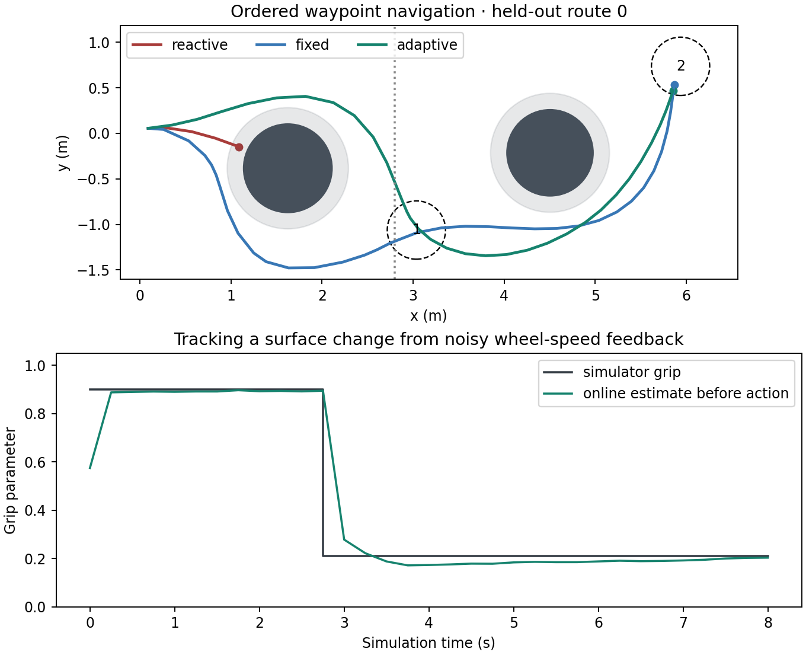

# Terrain Belief MPC · 未知抓地力下的移动机器人预测控制

机器人要依次到达两个航点，途中有圆形障碍物。场地可能全程干燥、全程湿滑，或在 x=2.8 m 处换地面。控制器知道地图和当前位姿，可以读取含噪的线速度和角速度。自适应控制器需要从已执行的指令及反馈在线估计抓地力。

## 控制方法

- **动力学辨识** · 从 512 段独立随机控制序列采集 16,384 次模拟转移，用带抓地力条件的残差 MLP 预测下一步线速度与角速度，再用中点航向积分更新位姿。训练使用模拟器提供的地面参数。128 段独立验证轨迹上，给定真实地面参数时，12 步开环平均位置误差为 0.0193 m。
- **在线地面估计** · 在 18 个候选抓地力值上维护离散后验。根据执行动作后实际观测到的速度与各模型预测的残差更新概率，混入 5% 均匀先验以支持地面突变。下一轮规划使用后验均值。
- **滚动规划** · 每轮 CEM 采样 96 条分段常值动作序列，向前预测 12 步，保留 12 条精英序列，迭代两轮。代价包括目标距离、转向、近障和碰撞。使用移动圆盘扫过的线段检查碰撞。执行最佳候选的首步，下一轮利用新观测重新规划。
- **消融** · 对比直接朝航点转向、固定干地参数 MPC、在线估计 MPC、获知当前真实抓地力的 MPC。最后一项仍使用学得的动力学与有限采样规划器，地面切换前也无法预知未来的参数。

## 同路线配对评测

32 条留出路线分别在三种地面条件和四种策略下运行，共 384 个回合。每步模拟时间 0.25 秒，64 步超时。进入半径 0.32 m 的航点区域计为到达，碰撞立即结束。

| 平均完成步数 | 干燥 | 湿滑 | 途中换地面 |
| --- | ---: | ---: | ---: |
| 固定参数 MPC | 28.78 | 41.50 | 34.53 |
| 在线估计 MPC | 28.28 | 36.53 | 32.00 |
| 已知当前地面参数 MPC | 28.78 | 37.22 | 32.88 |

三种 MPC 均完成每个条件下的全部 32 条路线。直接朝航点转向的对照在每种条件下均碰撞 32 次。湿滑条件下，在线估计相对固定参数的平均路线长度从 7.96 m 降至 7.17 m。路线来自同一双航点、双圆障碍生成器。该结果衡量二维运动学仿真中的控制效率，尚未验证定位误差、未知地图或真实机器人部署。[逐路线结果](results/navigation.json) · [开环辨识评测](results/identification.json)

## 本地复现

实验使用 Windows、Python 3.12、PyTorch 2.8 和 RTX 4060 Laptop GPU。可直接使用仓库内权重复算评测。没有 CUDA 时自动使用 CPU。

~~~sh
python -m pip install -r requirements.txt
python -m unittest -v
python evaluate.py
python plot.py
~~~

从头训练运行 python dynamics.py，再运行评测和绘图。导航结果保存在 results/navigation.json，前六条路线的轨迹与逐步地面估计保存在 results/traces.json。
